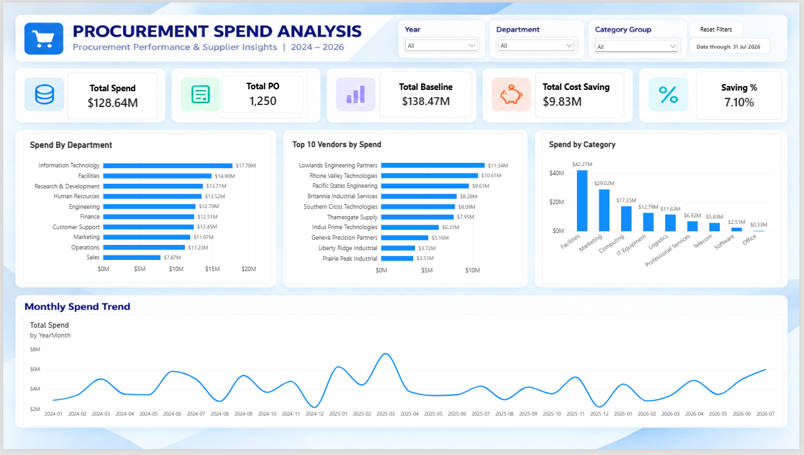
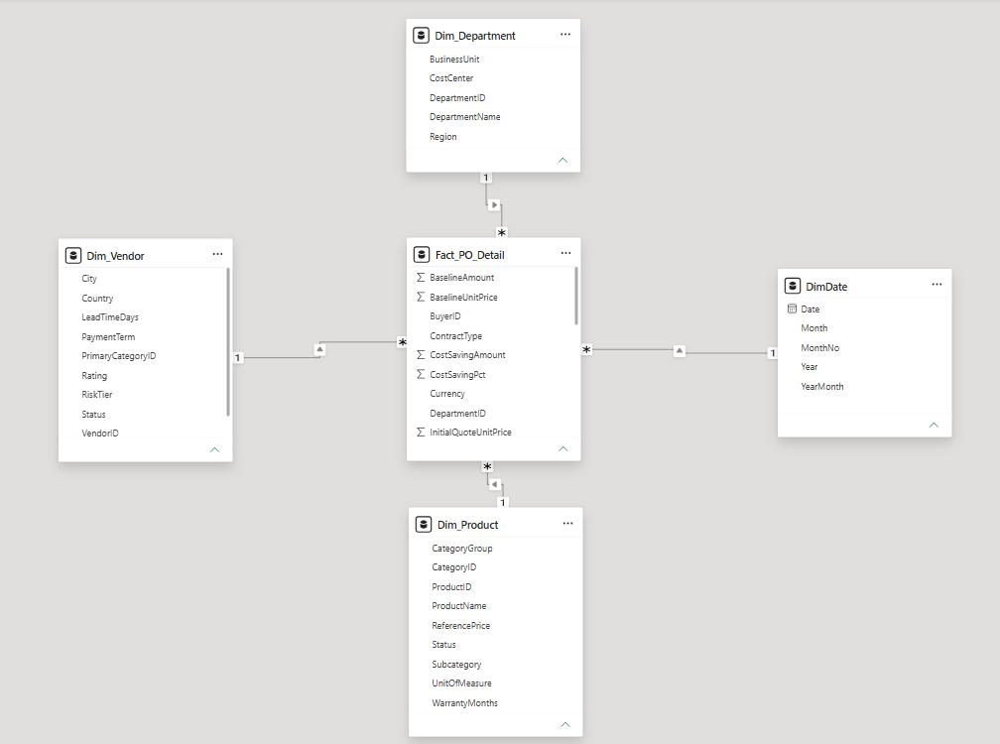

# Procurement Spend Analysis

A procurement analytics portfolio project using Excel, Power Query, SQL Server, and Power BI to explore spending patterns and savings against baseline.

## Business Objectives

- Monitor total procurement spend and purchase order volume.
- Compare purchase order amounts with baseline amounts.
- Identify departments, categories, and vendors with the highest spend.
- Explore monthly spending trends to support procurement planning.

## Tools Used

| Tool | Purpose |
|---|---|
| Excel and Power Query | Data preparation and transformation |
| SQL Server | Data analysis and KPI validation |
| Power BI and DAX | Data modeling, KPI calculations, and interactive reporting |

## Executive Overview

The dashboard includes:

- Total Spend
- Total Purchase Orders
- Total Baseline
- Total Cost Saving
- Saving Percentage
- Spend by Department
- Top 10 Vendors by Spend
- Spend by Category
- Monthly Spend Trend

Users can filter by year, department, and category group, and restore the default view using the Reset Filters button.

**Reporting period:** January 2024–July 2026  
**Latest transaction date:** 31 July 2026  
**Reporting currency:** USD

## Key Results

| Metric | Value |
|---|---:|
| Total Spend | $128,641,510.59 |
| Unique Purchase Orders | 1,250 |
| Total Baseline | $138,474,669.08 |
| Total Cost Saving | $9,833,158.49 |
| Saving Percentage | 7.10% |

Savings represent the difference between baseline and purchase order amounts, rather than verified cash savings.

## Key Insights

1. Purchase order spend was approximately $9.83 million below baseline, equivalent to 7.10% of the total baseline.
2. Facilities was the largest spending category at approximately $42.27 million, representing 32.9% of total spend.
3. Information Technology had the highest departmental spend at approximately $17.78 million.
4. Lowlands Engineering Partners was the largest vendor by spend at approximately $11.34 million, representing 8.8% of total spend.

These findings suggest prioritizing the Facilities category for further analysis of purchase volumes, unit prices, and supplier terms. High spending alone does not establish inefficiency or poor supplier performance.

## Data Model

The Power BI model follows a star schema:

- Fact_PO_Detail: purchase order line data
- Dim_Vendor: vendor information
- Dim_Department: department information
- Dim_Product: product and category information
- DimDate: calendar attributes

Dimensions filter the fact table through one-to-many relationships.

## KPI Validation

SQL calculations were compared with Power BI for:

- The full dataset
- The year 2025

All five KPI results matched at the precision displayed in the dashboard.

Total purchase orders are calculated using distinct PO IDs.
Saving percentage is calculated as total cost saving divided by total baseline, rather than an average of row-level percentages.

## Project Status

The dashboard and initial KPI reconciliation are complete.
Supporting files and documentation are being added to this repository.

## Dashboard Preview

### Executive Overview

### Data Model

