# Procurement Analytics — Data Cleaning & Validation Evidence

**Project:** Procurement Spend Analysis · **Tools:** Power Query, Power BI Desktop, SQL Server · **Dataset:** Synthetic procurement transactions (2025 subset)

> **Scope and integrity:** All screenshots document a controlled cleaning exercise using intentionally corrupted synthetic data. The original SQL Server `Fact_PO_Detail` is used as the reference for selected field recovery and POAmount checks. SQL Server is local and not included in this repository. The original dashboard model and its production-facing KPI definitions are not claimed to have been refreshed with this exercise dataset.

## Overview

| Stage | Observed before | Observed after | Verification status |
| --- | --- | --- | --- |
| 01. Duplicate detection and removal | 1,185 input rows; 1,178 distinct `PO_Line_ID` values; 7 extra duplicate rows | 1,178 rows; 1,178 distinct and unique `PO_Line_ID` values | **Verified in Power Query** |
| 02. Missing VendorID recovery | Six blank-string (`""`) `VendorID` fields | Six recovered from matching SQL reference rows | **Six examples verified** |
| 03. Numeric type / locale correction | `Int64.Type` for decimal-valued measures; decimal separators misinterpreted | `type number` conversion with `en-US` locale yields expected values in inspected examples | **Sample values verified; full numeric-column audit pending** |
| 04. Missing POAmount recovery | Seven blank-string `POAmount` fields | Seven values recovered from SQL reference | **Seven examples verified** |
| 05. Incorrect POAmount detection and correction | Six source amounts were 10× their SQL reference | Corrected `POAmount_Final` values matched reference for those six | **Six examples verified** |
| 06. Transaction-level POAmount reconciliation | Six nonzero differences for `POAmount_Clean` | 1,178 zero differences for `POAmount_Final` (rounded to two decimals) | **All 1,178 validated** |

## 01. Duplicate detection and removal

**Before:** The dirty 2025 data contained 1,185 rows, 1,178 distinct `PO_Line_ID` values, and 7 additional records that duplicated existing rows.

| Before: dirty dataset | After: deduplicated dataset |
| --- | --- |
| 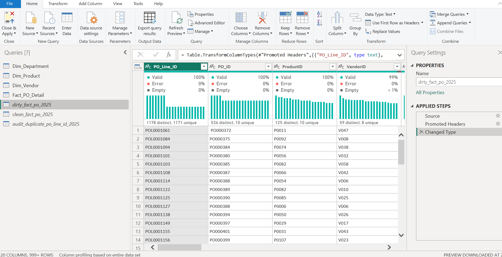 | 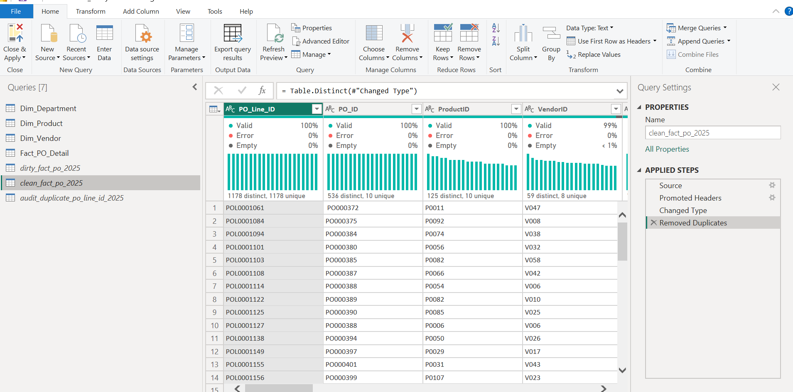 |

**Additional verification:** 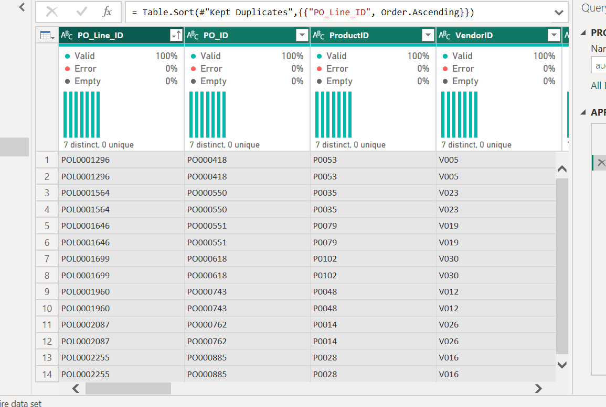

**Method:** Investigate duplicate identifiers, test full-row identity using `Table.Distinct` on all columns, then remove exactly repeated rows from `clean_fact_po_2025`.

## 02. Missing VendorID recovery

**Before:** Six records contained empty strings in `VendorID` (not `null`). **After:** Those records were matched by `PO_Line_ID` to the SQL `Fact_PO_Detail` reference, then repaired in a separate `VendorID_Clean` column.

| Before: six empty VendorID | After: six recovered VendorID |
| --- | --- |
| 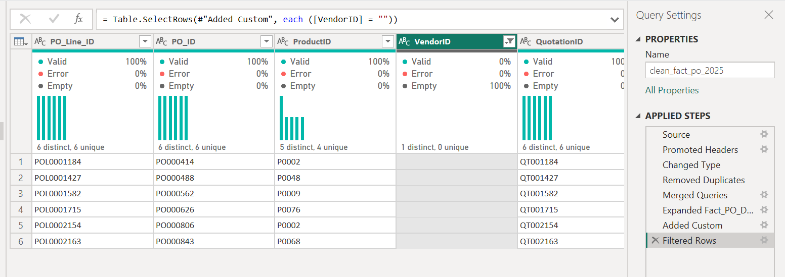 | 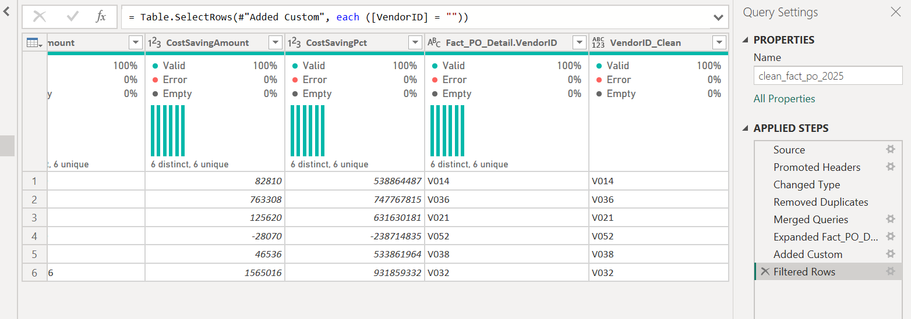 |

**Join check:** 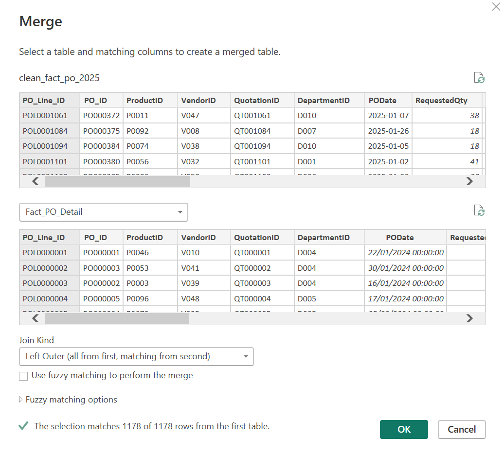

**Method:** Left Outer merge from the cleaned 2025 table to the SQL fact reference, then conditionally recover only `null`, empty-string or whitespace-only IDs. This rule does **not** automatically correct all nonblank invalid IDs.

## 03. Numeric type and locale correction

**Before:** The import step used `Int64.Type` for decimal amounts and rates. Values such as `0.0527997907` were erroneously represented as large integers. **After:** The `Changed Type` step was updated to `type number` with `en-US` locale and example amounts/rates were restored.

| Before: misparsed numeric values | After: corrected decimal values |
| --- | --- |
| 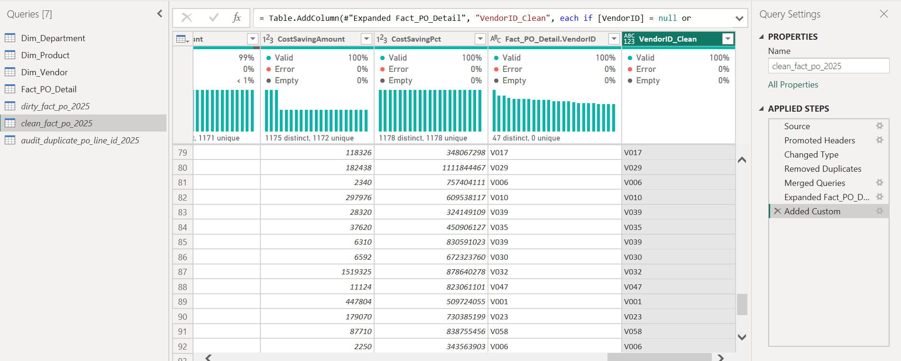 | 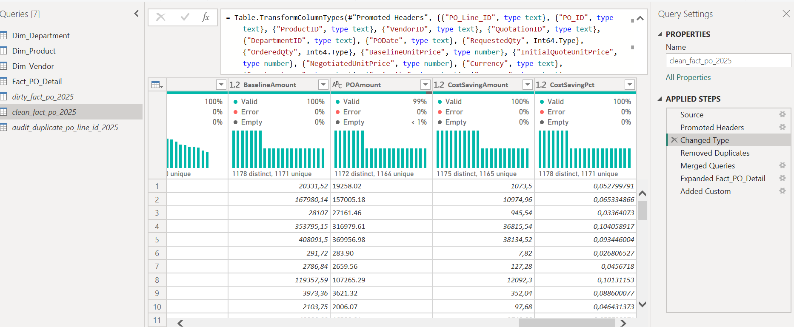 |

**Cause evidence:** 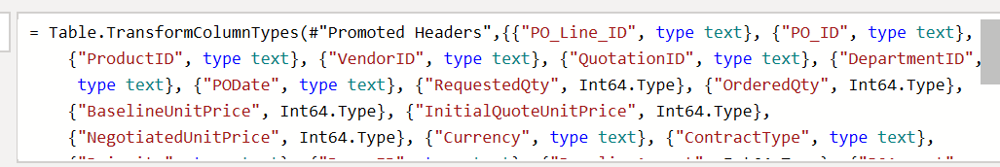

**Example check:** `BaselineAmount` 2,033,152 → 20,331.52; `CostSavingAmount` 107,350 → 1,073.50; `CostSavingPct` 527,997,907 → approx. 0.052799791 (5.28%). These values are for the inspected rows, not a claim that all numeric fields were validated.

## 04. Missing POAmount recovery

**Before:** Seven transactions had an empty-string `POAmount`. **After:** Seven numeric values were retrieved from the matching SQL `Fact_PO_Detail.POAmount` through `POAmount_Clean`.

| Before: seven missing amounts | After: values recovered from reference |
| --- | --- |
| 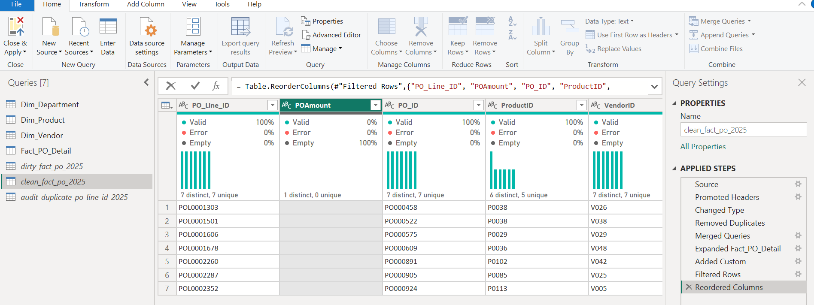 | 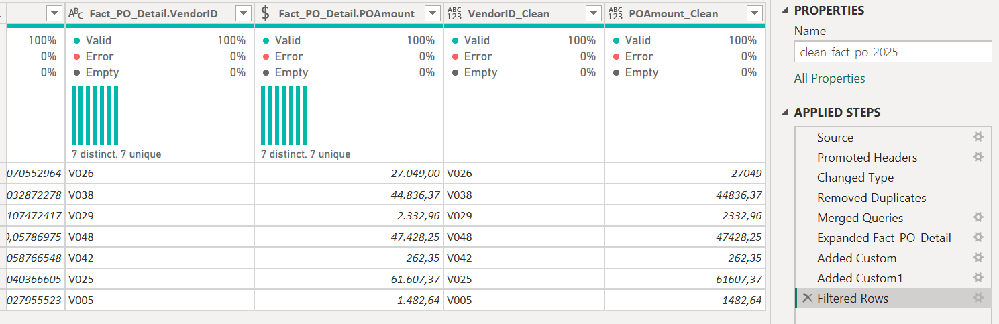 |

**Method:** `Number.FromText(..., "en-US")` for populated text and fallback to the trusted SQL amount for blank or null values. Subsequent validation was conducted at transaction level.

## 05. Incorrect POAmount detection and correction

**Before:** Six populated `POAmount` values were exactly 10× the corresponding SQL reference amounts. **After:** `POAmount_Final` was populated from the trusted SQL reference for mismatches.

| Before: six tenfold overstatements | After: corrected POAmount_Final |
| --- | --- |
| 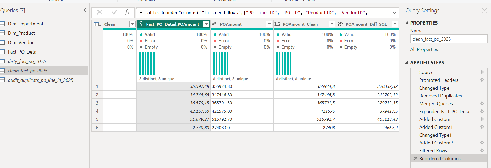 | 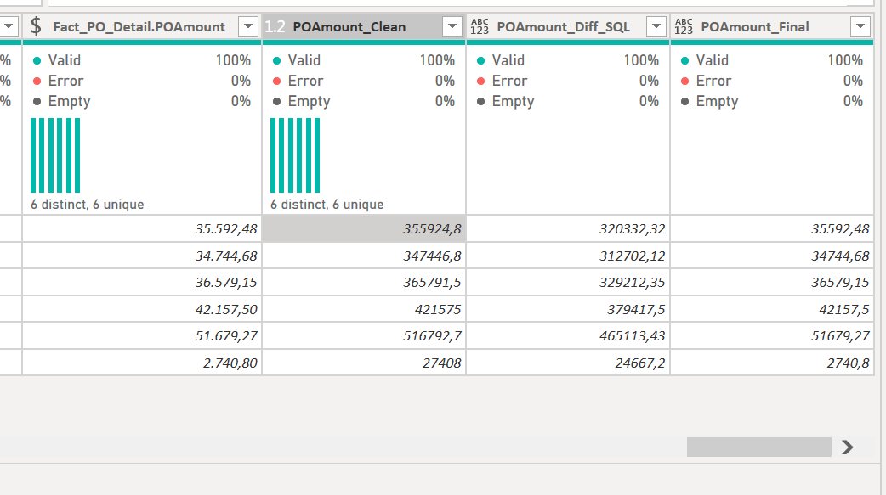 |

**Note:** Correction by replacing a mismatched value with a reference value is suitable for this synthetic exercise because the reference was designated as authoritative. Production corrections would require confirmation of source-of-truth rules and appropriate change approval.

## 06. Final transaction-level amount validation

**Before:** Six records had nonzero `POAmount_Diff_SQL`. **After:** `POAmount_Final_Diff_SQL = Number.Round([POAmount_Final] - Number.From([Fact_PO_Detail.POAmount]), 2)` had a zero difference across all 1,178 records.

| Before: nonzero differences | After: all differences are zero |
| --- | --- |
| 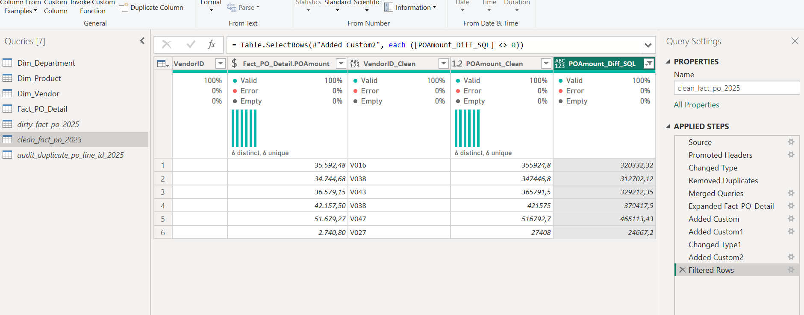 | 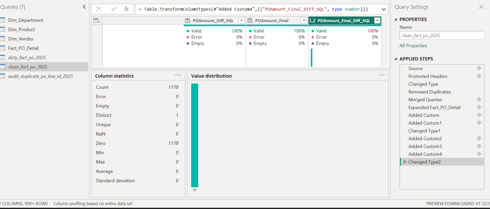 |

**Observed final column statistics:** `Count = 1,178`, `Error = 0`, `Empty = 0`, `Distinct = 1`, `Zero = 1,178`, `Min = 0`, `Max = 0`. **Interpretation:** Every final POAmount matches the selected SQL reference to two decimal places; this does not independently prove that the reference is error-free or that other fields match.

## Reproducibility and evidence rules

1. Keep `dirty_fact_po_2025` as the untouched, intentionally corrupted training source; retain `clean_fact_po_2025` for the transformed output and `audit_duplicate_po_line_id_2025` for duplicate investigation.
2. Preserve intermediate audit fields (`VendorID_Clean`, `POAmount_Clean`, `POAmount_Diff_SQL`, `POAmount_Final`, `POAmount_Final_Diff_SQL`) until verification screenshots and data outputs are captured.
3. Use original source screenshot files; do not present an illustrated or synthetic screenshot as an actual Power Query run.
4. Maintain **Enable Load = off** on training and audit queries if they must not affect the existing Power BI dashboard model.
5. Before releasing a final cleaned table, explicitly set the final amount column type to Decimal Number and the final Vendor ID type to Text, and decide which original/reference/audit fields belong in the deliverable.

## Open checks — not yet verified

- Referential-integrity review for nonblank but invalid vendor keys such as `V999`.
- Other intentionally introduced dirty-data scenarios (e.g., department keys, PO dates, whitespace, and data-quality anomalies) as applicable.
- 2025 aggregate KPI reconciliation (`Total Spend`, `Total Baseline`, `Total Saving`, and `Saving %`) using the intended cleaned fields against the original SQL reference.
- Final published `.pbix` update/refresh strategy and documentation for reproducing the training query results.

## Evidence file manifest

All images below are original screenshots supplied during the exercise, **renamed only** for GitHub readability; the screenshot pixels were not edited.

- [`01_duplicate_before.png`](../images/data_cleaning/01_duplicate_before.png) — source screenshot `image(20261105-123057).png`
- [`01_duplicate_audit.png`](../images/data_cleaning/01_duplicate_audit.png) — source screenshot `image(20261102-030041).png`
- [`01_duplicate_after.png`](../images/data_cleaning/01_duplicate_after.png) — source screenshot `image(20261105-122944).png`
- [`02_missing_vendor_before.png`](../images/data_cleaning/02_missing_vendor_before.png) — source screenshot `image(20261110-032305).png`
- [`02_vendor_merge_match.png`](../images/data_cleaning/02_vendor_merge_match.png) — source screenshot `image(20261110-030625).png`
- [`02_missing_vendor_after.png`](../images/data_cleaning/02_missing_vendor_after.png) — source screenshot `image(20261110-032240).png`
- [`03_numeric_before_values.png`](../images/data_cleaning/03_numeric_before_values.png) — source screenshot `image(20261110-031458).png`
- [`03_numeric_before_formula.png`](../images/data_cleaning/03_numeric_before_formula.png) — source screenshot `image(20261110-061342).png`
- [`03_numeric_after.png`](../images/data_cleaning/03_numeric_after.png) — source screenshot `image(20261110-062529).png`
- [`04_missing_poamount_before.png`](../images/data_cleaning/04_missing_poamount_before.png) — source screenshot `image(20261110-064100).png`
- [`04_missing_poamount_after.png`](../images/data_cleaning/04_missing_poamount_after.png) — source screenshot `image(20261110-065909).png`
- [`05_incorrect_poamount_before.png`](../images/data_cleaning/05_incorrect_poamount_before.png) — source screenshot `image(20261110-084658).png`
- [`05_incorrect_poamount_after.png`](../images/data_cleaning/05_incorrect_poamount_after.png) — source screenshot `image(20261110-143307).png`
- [`06_poamount_validation_before.png`](../images/data_cleaning/06_poamount_validation_before.png) — source screenshot `image(20261110-084425).png`
- [`06_poamount_validation_after.png`](../images/data_cleaning/06_poamount_validation_after.png) — source screenshot `image(20261110-144354).png`
